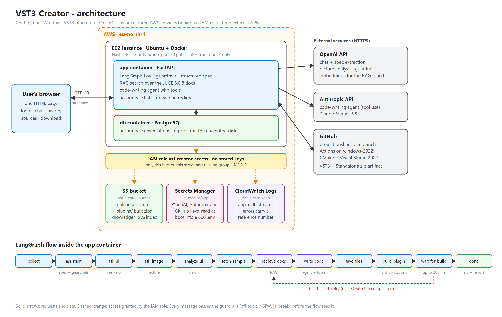

# VST3 Creator


Who the app is for: musicians and studio engineers working with DAWs (digital audio workstations).

Technology: langchain and langgraph, because it's a web application

Prompt improvements?

Known limitations: 
 - sometimes (in rare cases) the app can build but crash. Possible solution: have a step in the workflow that starts the standalone plugin and checks for the exit code. If this step fails, go back to the coding step
 - you cannot refine (currently, but it can be done in the future)
 - sometimes the build fails with errors that have been encountered before. Possible solution: keep a "lessons learned" file
 - the branches still exist after building 

Prompt improvements:
 - make sure to mention the JUCE library explicitly (some build failures were due to version mismatch)
 - tell the prompt explicitly not to ask for UI designs at first 
 
IAM role: 
vst-creator-access


Describe an audio plugin in a chat and get a built Windows **VST3 plugin** (plus a Standalone app) to download.

- **User:** a musician or sound designer who wants a plugin but does not write C++.
- **Problem:** turning a loose idea ("a warm low-pass filter with a dark UI") into a working, compiled plugin.
- **Result:** a zip with the built VST3 and Standalone, plus a report of the JUCE documentation used, what the
  model assumed, and whether the result needs human review.

## How it works

```
chat (web page)
  collect -> assistant ........ extracts a structured plugin spec; asks until it is complete and confirmed
  ask_ui -> ask_image -> analyze_ui .... optional picture of the wanted UI, described by a vision model
  fetch_sample -> retrieve_docs ........ sample project + RAG search over the JUCE 8.0.8 headers
  write_code ........ tool-calling agent (search docs, read samples, validate, submit)
  save_files -> build_plugin -> wait_for_build .... GitHub Actions builds it with Visual Studio
  done: download link + "Sources and notes" report   |   failed: back to retrieve_docs with the build errors
```

Guardrails (off-topic, NSFW, jailbreak; medium strictness) check every message before the graph sees it.
Failed calls are retried and shown as friendly errors with a "Try again" button.

| Part | Choice |
|---|---|
| Orchestration | LangGraph (state machine with interrupts for the chat turns) |
| Chat, picture analysis, guardrails, embeddings | OpenAI (`gpt-4.1`, `gpt-4.1-mini`, `text-embedding-3-small`) |
| Code writing | Anthropic `claude-sonnet-5-5` as a tool-calling agent |
| Knowledge base | JUCE 8.0.8 headers, chunked per doc comment, embedded, searched with cosine similarity (`rag.py`) |
| Backend / frontend | FastAPI (streaming NDJSON) / one hand-written HTML page, no framework |
| Storage | PostgreSQL (accounts, conversations, reports), S3 bucket on AWS (uploads, built plugins, knowledge index) |
| Build | GitHub Actions on `windows-2022`, CMake + Visual Studio 2022 |

## Architecture



(Editable source: `docs/architecture.svg`. The text version below shows the same layout.)

```
Browser (one HTML page)
   |  HTTP :80, streamed NDJSON
   v
AWS EC2 (Ubuntu, Docker)  --- IAM role, no stored keys --->  S3: uploads, built plugins, knowledge index
 +-- app container: FastAPI + LangGraph + guardrails         Secrets Manager: API keys (read at boot)
 +-- db container: PostgreSQL (accounts, chats, reports)     CloudWatch Logs: app and db logs
   |
   +--> OpenAI API (chat, picture analysis, guardrails, embeddings)
   +--> Anthropic API (code-writing agent)
   +--> GitHub API / Actions (build on windows-2022, returns the zip)
```

- **One instance, two containers.** The browser talks only to the FastAPI app on port 80. It runs the LangGraph
  flow, calls the AI services and keeps state in PostgreSQL. Chat turns in progress live in the app's memory.
- **Grounding.** The agent searches a vector index of the JUCE headers (kept in the image, copy on S3) and the
  answer ships with the sources used and a "needs review" flag.
- **Build.** The generated project is pushed to a throwaway branch, GitHub Actions builds it with Visual Studio,
  and the app downloads the artifact, stores the zip on S3 and offers it through a short-lived link.
- **Security.** Only port 80 is public (SSH from one IP); the instance role can reach just its own bucket, log
  group and secret; secrets are in Secrets Manager; every message passes the guardrails first.

## Run it locally

Needs Python 3.11+, Docker (for Postgres) and the keys below.

```
cp .env.example .env            # then fill in the keys (see below)
pip install -r requirements.txt
docker compose up -d db         # Postgres on 127.0.0.1:5432
python -m uvicorn server:app --port 8000        # http://127.0.0.1:8000
```

`.env` keys: `OPENAI_API_KEY`, `ANTHROPIC_API_KEY`, `GITHUB_TOKEN`, `GITHUB_REPO` (owner/name of the repo whose Actions
build the plugin), `POSTGRES_PASSWORD`, `DATABASE_URL` (`postgresql://vst:<password>@127.0.0.1:5432/vst`).
Optional: `OPENAI_MODEL`, `ANTHROPIC_MODEL`, `GUARD_BLOCK_CONFIDENCE`, `MAX_BUILD_ATTEMPTS`, `LANGSMITH_*`.

The RAG index is committed in `rag_data/index/`. To rebuild it from the JUCE headers in `rag_data/juce_modules/`:
`python build_rag_index.py` (costs a few cents of embeddings).

## What is stored where

| Data | Where | Notes |
|---|---|---|
| Accounts (scrypt-hashed passwords), conversations, messages, the "Sources and notes" report | PostgreSQL (Docker volume on the encrypted instance disk) | |
| Built plugins (zip with VST3 and Standalone) | S3: `plugins/<conversation id>/vst3.zip` | The database keeps the S3 address; the download button redirects to a 5-minute link, issued only to the conversation's owner |
| Uploaded UI pictures | S3: `uploads/<conversation id>/<random>.<ext>` | Saved after the input checks and guardrails pass; the message row records the location |
| Knowledge data (RAG index of the JUCE docs) | In the Docker image, with a copy in S3: `knowledge/index/` | The app downloads the copy if the index is missing from the container |
| API keys and tokens | AWS Secrets Manager (`vst-creator/app`) | Read at boot with the instance's IAM role, written to a `chmod 600` `.env` for Docker; never in git |
| Container logs (app and database) | CloudWatch Logs: log group `/vst-creator/app` (the stack uses `/vst-creator/<stack name>`), streams `app` and `db`, kept 30 days | Set by `LOG_GROUP` in the secret and `docker-compose.aws.yml`. Docker's own `docker logs` no longer shows them: read them in CloudWatch |

S3 is used when the `S3_BUCKET` setting exists (the AWS deployment sets it). Without it, for example when running
locally, the app keeps files on the local disk and everything else works the same. If an upload to S3 fails, the
failure is logged and the user's request still completes.

## Deploy on AWS (CloudFormation)

One template, `deploy/cloudformation.yaml`, creates everything in your own AWS account:

| Role | What the stack creates |
|---|---|
| Hosting | One EC2 instance (Ubuntu 24.04, `t3.small`) running the app and Postgres in Docker, with a fixed Elastic IP |
| Storage | A private, encrypted S3 bucket; Postgres data on the encrypted instance disk |
| Access | An IAM role limited to that bucket, that log group and its own secret; IMDSv2 required |
| Network | Security group: port 80 for everyone, port 22 only from the range you give (or no SSH at all) |
| Secrets | The API keys live in AWS Secrets Manager; the instance reads them at boot, they are not in the template output or the repo |
| Logs | Container logs go to CloudWatch Logs (`/vst-creator/<stack name>`, kept 30 days) |

### Before you start

1. **Fork this repository** on GitHub and make sure Actions is enabled on the fork. The plugin builds run in the
   fork's `Build VST3` workflow (`.github/workflows/build-vst.yml`, already in the repository).
2. **GitHub token:** create a fine-grained token, repository access = your fork only, permissions
   *Contents: read and write* and *Actions: read and write*.
3. **API keys** for OpenAI and Anthropic.
4. An AWS account with a **default VPC** in the region you use, and permission to create IAM roles.

### Create the stack

Console: CloudFormation -> Create stack -> upload `deploy/cloudformation.yaml`, then fill in the parameters
(`OpenAIApiKey`, `AnthropicApiKey`, `GitHubToken`, `GitHubRepo` = `<you>/<fork>`, `RepoUrl` = your fork's clone URL;
`SshCidr` = `<your public IP>/32` if you want SSH, otherwise leave it empty). Tick the box that allows IAM resources.

CLI:

```
aws cloudformation deploy --stack-name vst-creator --template-file deploy/cloudformation.yaml \
  --capabilities CAPABILITY_IAM --region eu-north-1 \
  --parameter-overrides OpenAIApiKey=sk-... AnthropicApiKey=sk-ant-... GitHubToken=github_pat_... \
    GitHubRepo=<you>/<fork> RepoUrl=https://github.com/<you>/<fork>.git SshCidr=<your-ip>/32
aws cloudformation describe-stacks --stack-name vst-creator --query "Stacks[0].Outputs" --region eu-north-1
```

The stack reaches `CREATE_COMPLETE` only after the app answers its health check, which takes about 5-10 minutes
(Docker image build included). The `AppUrl` output is the address: open it, create an account and describe a plugin.
If the stack fails, the reason is in the stack events; on the instance `/var/log/vst-setup.log` has the full setup log.

### Check that it works

- `http://<AppUrl>/healthz` returns `{"ok":true}`.
- Create an account, describe a plugin, confirm it. The graph-state label on the left follows the steps and the
  download link appears after the build (usually 3-6 minutes of GitHub Actions time).
- Container logs: CloudWatch -> Log groups -> `/vst-creator/<stack name>`.

### Update a running deployment

Push your change to the branch the stack uses, then on the instance (SSH) run
`cd /opt/vst-creator && git pull && sudo docker compose -f docker-compose.yml -f docker-compose.aws.yml up -d --build`.
(`deploy-ec2.sh` is the author's own helper for an instance created by hand and is not needed for the stack.
It pulls the code, refreshes `.env` from the Secrets Manager secret with `--secrets`, rebuilds the containers and
waits for the health check. The IAM role of that instance may read only the bucket, one log group and one secret.)

### Clean up

1. Empty the S3 bucket (CloudFormation cannot delete a bucket that still has files):
   `aws s3 rm s3://<BucketName output> --recursive`
2. Delete the stack: `aws cloudformation delete-stack --stack-name vst-creator`.
   This removes the instance, Elastic IP, security group, IAM role, secret and log group.
3. Delete the fork's token on GitHub if you no longer need it.

Cost while running is mostly the `t3.small` instance plus the public IPv4 address (roughly 15-20 USD a month in
total; see the AWS pricing pages for your region). Deleting the stack stops all charges.

## Files

| File | Purpose |
|---|---|
| `main.py` | The LangGraph graph, prompts and nodes |
| `agent.py` | The code-writing agent and its tools |
| `rag.py`, `build_rag_index.py` | JUCE documentation index and search |
| `spec.py` | The structured plugin spec: validation and display |
| `guardrails.py`, `resilience.py` | Input guardrails and validation; retries and friendly errors |
| `github_build.py`, `.github/workflows/build-vst.yml` | Pushes the project to GitHub and builds it |
| `server.py`, `auth.py`, `chats.py`, `static/index.html` | Web API, accounts, saved conversations, the page |
| `storage.py` | S3 storage for uploads, built plugins and the knowledge index (off when `S3_BUCKET` is not set) |
| `deploy/load-secrets.sh` | Runs on the server: writes `.env` from the Secrets Manager secret |
| `Dockerfile`, `docker-compose.yml`, `docker-compose.aws.yml` | Container setup (the second file adds CloudWatch logging) |
| `deploy/cloudformation.yaml`, `deploy-ec2.sh` | AWS deployment |

Conversations in progress are held in memory by a single worker, so a restart ends any open chat
(finished ones stay in the database).
